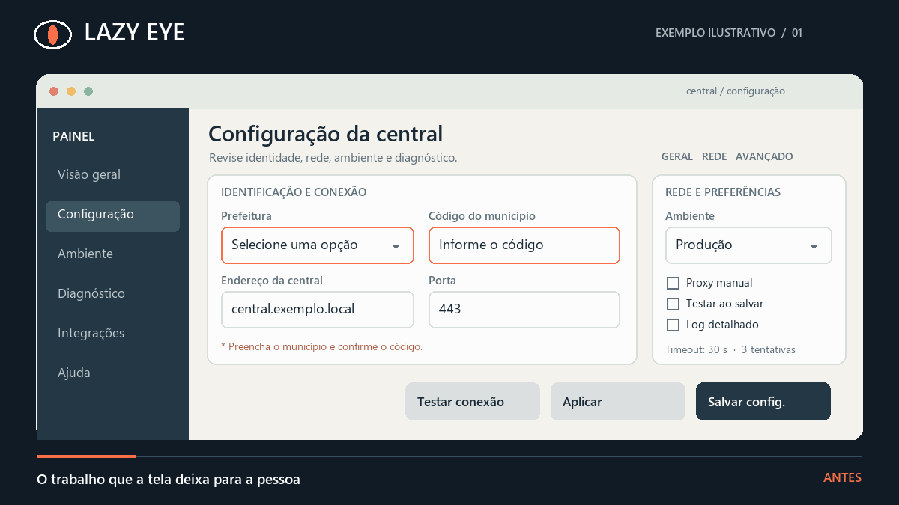

# Lazy Eye

**Uma skill para encontrar o trabalho que uma interface deixa para a pessoa.**

<picture>
  <source media="(prefers-reduced-motion: reduce)" srcset="./assets/lazy-eye-static.png">
  
</picture>

*Cenário simulado, não uma captura da Central CIGO: mapa do trabalho, auditoria, aprovação, refinamento visual, exceção autorizada e resultado confirmado.*

Uma tela pode parecer simples e ainda obrigar alguém a procurar um código, repetir uma escolha, consultar o suporte ou descobrir que o botão **Concluído** não concluiu nada. A Lazy Eye percorre a tarefa inteira, encontra esse esforço e propõe uma mudança concreta. Ela mede o caminho até o resultado, não apenas a quantidade de cliques.

Funciona em telas, formulários, configuradores, instaladores, fluxos de CLI e tarefas recorrentes. É uma [Agent Skill](https://agentskills.io/) escrita em português.

## Dois modos de trabalho

| Pedido | O que você recebe |
| --- | --- |
| Criar ou melhorar um fluxo | Uma sugestão principal: atrito observado, mudança proposta, esforço poupado e custo ou limite. |
| Auditar tudo o que pode ser simplificado | Um inventário de achados com evidência, risco, confiança, antes/depois e IDs para aprovar todos ou escolher alguns. |

A skill **apresenta a sugestão antes de alterar o fluxo** quando a melhoria está fora do pedido já autorizado. Numa auditoria profunda, só pede aprovação de implementação depois de examinar as evidências necessárias. Se faltarem tela, código ou outros dados essenciais, entrega um inventário preliminar e explica a lacuna.

### O mapa do trabalho

Antes de desenhar a solução, a Lazy Eye registra o caminho até um resultado verificável: ponto de partida → busca ou decisão → ação → confirmação → resultado. Compara o caminho atual com o proposto, incluindo a exceção e o trabalho que poderia migrar para o suporte. Na animação, isso significa tirar a consulta externa do fluxo comum, manter a troca de município quando autorizada e só declarar o fim depois que o salvamento for confirmado.

### Quando a tela também precisa de design premium

A Lazy Eye decide **o que simplificar**. Se a tarefa incluir criação ou redesign de UI, ela pode combinar esse diagnóstico com o `impeccable` para estruturar, criticar ou polir a interface. Skills de direção visual, movimento e acessibilidade entram somente quando resolvem uma lacuna específica. O resultado é uma única proposta de fluxo e visual, mantendo identidade, regras e aprovação; nenhuma dessas skills é obrigatória para usar a Lazy Eye.

| Papel | Skill, quando disponível |
| --- | --- |
| Encontrar e reduzir o trabalho da pessoa | `lazy-eye` |
| Estruturar, simplificar e polir a interface | `impeccable` |
| Definir uma direção visual própria, se faltar | `design-taste-frontend` |
| Refinar movimento com propósito, se houver | `emil-design-eng` ou `animate` |
| Conferir uma questão específica de acesso | `accessibility` |

## A escada do esforço poupado

Para cada atrito, ela tenta os degraus nesta ordem. Para no primeiro que resolve a tarefa com segurança; caminhos de exceção podem combinar degraus.

| Degrau | Pergunta | Exemplo |
| --- | --- | --- |
| **01 · Eliminar** | Esta etapa precisa existir? | Remover uma confirmação duplicada. |
| **02 · Resolver pelo contexto** | O sistema já conhece a resposta por fonte confiável? | Propor a prefeitura vinculada à conta, com troca autorizada. |
| **03 · Padrão seguro** | Existe uma escolha comum e de baixo risco? | Oferecer um valor inicial claro e editável. |
| **04 · Adiar** | A decisão só importa em alguns casos? | Mostrar opções avançadas quando forem relevantes. |
| **05 · Facilitar** | A ação humana continua necessária? | Usar busca numa lista extensa; manter um `select` para poucas opções claras. |

Validação, acessibilidade, feedback, recuperação de erros e controle sobre consequências permanecem em todos os degraus. A skill não presume consentimento nem automatiza decisões sensíveis.

## Exemplo: instalador que diz “Concluído” cedo demais

**Antes:** instalar → ver “Concluído” → tentar abrir → descobrir dependência ausente → pesquisar uma versão → instalar → repetir → chamar suporte se falhar.

**Proposta:** verificar a dependência e sua compatibilidade; orientar a correção dentro do instalador; mostrar “Concluído” somente quando o aplicativo estiver apto a abrir. Instalar a dependência automaticamente só entra na proposta depois de confirmar origem, versão, licença e privilégios.

Numa auditoria profunda, a Lazy Eye também pergunta: *o que comprovaria o ganho?* e *o que mostraria que a hipótese estava errada?* Sem acesso ao instalador e aos requisitos, isso continua sendo uma proposta preliminar.

## Instalação

Instale globalmente no Codex, Claude Code e Antigravity com a [CLI de Agent Skills](https://github.com/vercel-labs/skills):

```bash
npx --yes skills@1.7.2 add https://github.com/iLuanInfortronics/lazy-eye --skill lazy-eye --global --agent codex claude-code antigravity --yes
```

Reabra a sessão do agente após a instalação. Você também pode copiar `SKILL.md` e `references/` para uma pasta `lazy-eye` no diretório de skills do agente.

### Como pedir

```text
Use a skill lazy-eye e sugira a principal simplificação desta tela antes de mudar o fluxo.
```

```text
Use a skill lazy-eye em modo de auditoria profunda. Examine esta tarefa inteira, liste todas as simplificações relevantes com evidências e traga os IDs para minha aprovação.
```

A seleção automática depende do agente e de quantas skills ele carrega. Mencionar `lazy-eye` explicitamente é o caminho mais previsível.

## Dentro do repositório

- [`SKILL.md`](./SKILL.md): gatilho, escada e limites do uso cotidiano.
- [`references/auditoria-profunda.md`](./references/auditoria-profunda.md): método de investigação, inventário e aprovação.
- [`references/design-premium.md`](./references/design-premium.md): composição opcional com skills de design para interfaces.
- [`assets/`](./assets/): animação do antes e depois, com versão estática para movimento reduzido.

## Licença

MIT. Veja [`LICENSE`](./LICENSE).
